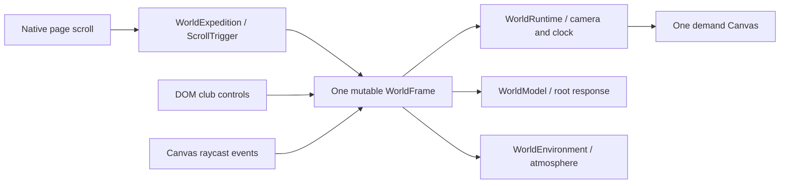

# FESTRONIX five-club 3D gallery implementation

**Updated:** 2026-10-07

**Status:** Current Flux A implementation; browser checks recorded below, performance certification and final approval pending.

**Workspace:** `D:\FESTRONIX\prototypes\festronix-visual`.

## Current scope and approval

The owner's attached brief explicitly authorized replacing the bounded Flux A
hero with a continuous immersive WebGL world. Subsequent owner steering replaced
the generic machinery subject with five club zones: Gaming, SDC (Student
Developer Club), Literature, CINE and OTAKU (anime), with more clubs later.
Current Flux A is that gallery. Pulse, Panel and Flux B/C remain comparisons.
The reference site informs motion/composition; none of its objects or media was
copied. Detailed licensed source meshes/PBR maps are the primary club objects.

Club names were supplied by the owner. Club descriptions and visual selection
are provisional. Club programs are unconfirmed; the spotlight says they will
appear once confirmed. Dates, sample events and archive editions remain
fictional prototype content. There is no connected backend, registration,
account, payment, club roster or live event availability. Final source/copy,
branding, institutional-logo permission and factual approval remain pending.

## Entry points and ownership

`FluxNarrative.tsx` routes variant A to `WorldExpedition`; B/C use the preceding
narrative. The gallery's decorative canvas is lazy-imported separately from
the useful HTML club/event information. Only one variant Canvas mounts at once.

| File in prototype `src/` | Responsibility |
| --- | --- |
| `WorldExperience.ts` | Five club definitions, model paths, placements, chapters and mutable frame record |
| `WorldExpedition.tsx` | Native-scroll sampling, HTML sections/anchors, loading/failure UI, selection, visibility and Canvas mount lifecycle |
| `WorldScene.tsx` | One demand Canvas, tier configuration, near-chapter model residency and owned local environment lighting |
| `WorldCamera.ts` | Reversible camera/gaze path sampling from current progress |
| `WorldRuntime.tsx` | Sole camera writer, shared elapsed clock, demand-frame scheduling, diagnostics, shader/context failure and adaptive downgrade signal |
| `WorldModel.tsx` | Per-instance fetch/decompress/parse ownership, ground fitting, pointer response and resource release |
| `WorldAssetLoader.ts` | Owned embedded-image decoding, cancellation, bitmap/texture disposal and fallback blob URL cleanup |
| `ClubDisplayTexture.ts` | Decorative original editor texture/UV mapping on the sourced laptop LCD |
| `WorldEnvironment.tsx` | Instanced gallery envelope/plinths, subtle atmosphere and owned environment resources |
| `world.css` | Sticky backdrop, alternating copy lanes, chapter scrims, responsive and compact/static composition |

## Scroll path and transform contract

Ordinary document scroll owns gallery progress. One ScrollTrigger measures the
gallery from `top top` to `bottom bottom`, stores normalized progress in the
frame ref and updates React state only when the chapter changes. It does not
pin/rewrite the scroll position. Native anchors work for Arrival, every club,
the finale and shared event sections. Refresh samples current scroll; reverse
movement samples the same path instead of accumulating forward-only offsets.

The chapter breakpoints are Arrival 0, Gaming .10, SDC .27, Literature .44,
CINE .60, OTAKU .76 and FESTRONIX .90. `WorldCamera.ts` maps progress through
centripetal Catmull–Rom camera/gaze curves. Phone and tablet share the narrow
path, centered on alternating club X positions ±3 with target Y=2.2. Runtime
updates perspective FOV to 64° phone / 52° tablet / 45° desktop when the viewport
changes. Compact club anchors reserve 88 px header clearance. `WorldRuntime`
alone writes camera transforms and advances `frame.time`; model/environment
consumers sample them. The pointer contributes only a damped, bounded offset.

Each model is first rotated according to its club definition, uniformly fitted
to the requested maximum dimension, centered in X/Z and ground-seated at
Y=-0.798. A separate root supplies world placement and interaction tilt. Model
positions/normals/source topology remain; display enlargement is gallery
staging, not true relative scale between a laptop, controller and sword.
Club sources have no imported animation clips. Current club interaction is
bounded root tilt and environment-material highlight; it does not pretend to
expose manufacturer internals or replace detailed parts with generated boxes.

The envelope uses reusable geometry/instanced material batches for walls,
plinths and light strips. Its original small brushed-floor texture and low-count
atmosphere are supporting scenery. A local Three.js `RoomEnvironment`/PMREM
provides source-material reflections; no provider preview/HDRI was acquired.

## Objects and source modifications

The current slots are Gamepad, Classic Laptop, four full source Encyclopedia
volumes, Vintage Video Camera and a combined Antique Katana/wooden stand.
Their 66,612 total source triangles remain in both texture tiers. The camera's
original alpha was restored into its glass material. Four complete source
books are batched into their original cover/paper groups and rotated into a
stack. The katana and stand preserve relative source metre scales, geometry,
UVs and maps; only indices/buffers and authored exhibit poses are combined.
The katana has a bare engraved blade and wrapped hilt, with no scabbard.

All external club sources are Poly Haven **CC0 1.0 Universal**, with source
pages, creator names, API metadata and published MD5 evidence retained locally.
These are authored textured meshes, not claimed manufacturer CAD, physical
photographs or photogrammetry scans. No copyrighted anime character/game asset
was acquired. Source preview renders and logos are excluded. See
[ASSET_MANIFEST.md](ASSET_MANIFEST.md) and
[SOURCES.md](../assets/3d/SOURCES.md) for exact paths, creators, bounds and costs.

At runtime, the original laptop LCD receives a locally drawn 512×512 editor
CanvasTexture and local planar X/Y UVs. It is a decorative SDC display, with
factual text/actions still in HTML. The source GLB/body surfaces remain intact.
Its generated texture belongs to the model's explicit disposal owner.

Original FESTRONIX X-Core/robot assets and preceding licensed machinery remain
source history, not primary club subjects. Their authored prototype status and
costs are documented in [ORIGINAL_MODELS.md](../assets/3d/ORIGINAL_MODELS.md).

## Interactions and semantic content

Canvas pointer-over/click raycasts select the actual model root and request a
frame; HTML `Meet …` buttons provide the same spotlight action without requiring
precision clicking or hover. Engagement is an explicit toggle. The selected
spotlight includes the club description, unconfirmed-program note, event link
and Close control. A DOM-triggered opening focuses the spotlight; Close returns
focus to its stored trigger. Changing chapters clears an unrelated selection.
The selected club can filter the existing event UI; it does not assert a
confirmed club program. Desktop fine-pointer movement controls bounded response;
touch keeps native vertical panning and has the HTML buttons.

Wayfinding links and the arrival directory are ordinary anchors. The Canvas and
arrival poster are decorative/hidden from assistive technology. Compact club
illustrations have descriptive artifact alt text. Club headings,
descriptions, tags and actions remain semantic HTML across visual failure and
motion preferences. The parent menu/event/info modal blocks scene input and
scheduling while open. STATIC compacts the gallery and hides decorative
inspection controls; club/event information remains available.

## Tiers, residency and demand scheduling

| Mode | Current implemented behavior |
| --- | --- |
| FULL | Embedded 1024 px WebP maps, source geometry, antialiasing, soft shadows, DPR capped at 1.25 on desktop and 1 on phone; active/idle demand cadence target 60/24 fps |
| REDUCED | Embedded 512 px maps with the same source geometry, no shadow map/antialiasing, DPR 1; active/idle cadence target 30/15 fps |
| STATIC | No Canvas, animation loop or model fetch; compact semantic club sections and temporary decorative poster |

These cadences are scheduler settings, not achieved device performance. Desktop
defaults FULL, widths below 1024 px default REDUCED, and Save-Data defaults STATIC
where available. OS/user reduced motion forces STATIC. A gallery viewport at
most 540 px high also uses its compact/static layout. Manual quality overrides
automatic selection until the user enables adaptation again.

Arrival mounts Gaming only. Ordinary club chapters mount the current and
neighboring club definitions, unmounting the other model owners. The finale
mounts all five as small REDUCED displays even in FULL mode. The whole Canvas
stops scheduled work when hidden, offscreen or blocked; ten seconds fully
offscreen releases it. Re-entry reloads owned models. The idle loop is deliberate
bounded live ambience, with no continuous React state updates for transforms.

Active frame observations exclude hidden/offscreen/idle gaps and the initial
two-second compile warmup. Current adaptation uses five-second active sample
windows, two consecutive p95 windows above 30 ms FULL / 50 ms REDUCED and only
downward quality changes. It publishes browser diagnostic data attributes for
frame p95, active FPS, camera, calls, triangles and resource counts. These are
lab observations, not an exact GPU-memory meter or field INP/FPS claim.

The preceding architecture's 80k/25k triangle, 64/24 MiB residency and 1.5 MB/700 KB
scene-transfer targets are **not certified** for this larger gallery. REDUCED
retains source geometry; three neighboring exhibits can have 46,616 source
triangles and the finale 66,612 before scenery. CINE has six texture definitions
referencing three embedded images. The current loader shares decoded images and
`THREE.Source` per image; compatible sampler/color-space views can share GPU
uploads while distinct Texture objects retain their material/UV associations.
Theoretical RGBA8+mip arithmetic gives a conservative per-definition allowance
of approximately 96 MiB for FULL Literature+CINE+OTAKU or 33.3 MiB for all-five
REDUCED including the LCD, before environment/shadows. If all repeated CINE
views share compatible GPU storage, the corresponding arithmetic is approximately
80 / 29.3 MiB. Neither figure is measured residency or a certified allocation
bound across drivers/formats; current renderer observations must verify sharing
and budget acceptance. Compressed GLB bytes cannot determine GPU residency.

## Owned loading, cancellation and recovery

Every model instance uses uncached `fetch` with its own AbortController. Received
bytes are counted for first-club progress when Content-Length is available.
Gzip is recognized by its magic bytes and decompressed before GLTF parsing;
cancellation is checked before/after decompression and after parse. Textures
must be embedded in the GLB. There is no provider API/CDN request or external
Draco/Meshopt/KTX2 decoder in this delivery format.

`WorldAssetLoader` owns texture views, shared image Sources, decoded bitmaps and
partial parser geometry/material results. It decodes once per embedded image
and shares its Source across definitions, retaining separate texture associations
where needed. Late parser dependency results are tracked/released even if no
complete scene commits. A canceled late bitmap decode closes the bitmap. The
HTMLImage fallback removes its abort
listener and revokes its blob URL through `finally` on every outcome. Decode
errors reject loading instead of silently displaying an untextured object.
On errors/unmount/tier change, loading aborts and geometry, materials, textures
and decoded images are released. Late parsed scenes are disposed instead of
committed. Fit/rotation changes also recreate the owner; the displayed primitive
is cleared before disposed geometry can remain in React state. Local PMREM,
environment geometry/materials and shadow maps have separate explicit owners.

Readiness follows model commit and shader compilation. Initial loading has a
15-second fallback timeout. Context loss, shader failure, lazy-module errors and
first-club failure expose useful HTML and a retry control. Later object failure
leaves club content available and offers model retry. Asset retry remounts the
owners; a rejected lazy-module import requires page reload to retry that module.
Current fallback art is locally rendered from the same gallery `WorldScene`
through `tools/world-poster.tsx`: `arrival.webp` is a 1000×700 decorative
loading/static/error backdrop (8,768 bytes), and five 550×540 club crops are
lazy-loaded in compact STATIC/error sections (6,250 Gaming; 8,868 SDC; 6,770
Literature; 8,276 CINE; 4,854 OTAKU bytes). All live under
`public/models/clubs/posters/`; six files total 43,786 bytes. They copy no
provider preview/reference artwork and bake in no mandatory facts or actions.
The source ledger/manifest record dimensions, provenance and alt behavior;
final crop/material approval remains pending.

## Verification record and remaining review

The root reported these local production checks on 2026-10-07. Viewports are CSS pixels, not physical-phone measurements.
Detailed evidence and limitations are in [CLUB_GALLERY_QA.md](CLUB_GALLERY_QA.md).

- **Files:** fourteen individual and two combined OTAKU GLBs passed container, embedded-WebP and geometry/hash inspections; source downloads matched MD5.
- **Production build:** `npm run build` passes TypeScript and Vite. Reported gzip
  chunks: initial JS 139.24 KB, CSS 13.19 KB, WorldScene 9.53 KB, shared deferred
  GLTF 251.32 KB, retained B/C 8.72 KB. Vite's existing chunk-size warning remains.
- **Composition:** all five clubs checked at 390×844, 768×1024, 1440×900 and 1920×1080;
  no horizontal overflow. Phone/tablet centering, FOV updates and static anchor clearance were corrected.
  FULL/REDUCED live and STATIC/user reduced motion checked; static has five club stills and zero Canvas.
- **Controls:** actual CINE/OTAKU mesh clicks open the correct spotlight; every
  DOM club control responds to Enter/Escape and returns focus to its trigger.
- **Failure/retry:** temporarily hiding the first model in `dist` leaves useful
  content, five stills and zero Canvas. Restoring it and Retry gives ready/one Canvas.
- **Residency lifecycle:** after ten seconds offscreen at FAQ, state is suspended
  with zero Canvas. Home recreates ready/one Canvas, seven geometries/six textures.
- **Renderer snapshots:** arrival 13 draws/14,554 triangles/7 geometries/6 textures;
  fresh CINE FULL 19/37,240/11/12 respectively. These are snapshots, not GPU budgets.
- **Busy-session diagnostics:** earlier multi-tab/cold-load FULL 35–46 fps with
  p95≈38–75 ms; REDUCED 22–28 fps with tails≈50–64 ms. These are not sustained,
  controlled, physical-device or certified benchmarks; scheduler targets are unproven.
- **Console:** final normal run warnings/errors `[]`; simulated missing-file errors were expected and separate.
- **Untested/PENDING:** physical midrange phone, GPU timing/residency, context loss and actual OS motion settings.
  Target GPU budgets are uncertified; deployment/publication is not claimed.
- **Approval PENDING:** final visual, source selection, copy, identity, institution
  branding and factual approval before representing this as the live festival.

Run from the prototype with `npm run dev` (local port 4180) or `npm run build`
(TypeScript check then Vite build). Review A explicitly at
`http://127.0.0.1:4180/?theme=Flux&variant=A&quality=FULL#main`; also inspect
REDUCED and STATIC. The functional checks above do not replace the pending
physical-device/performance evidence or final approval.
